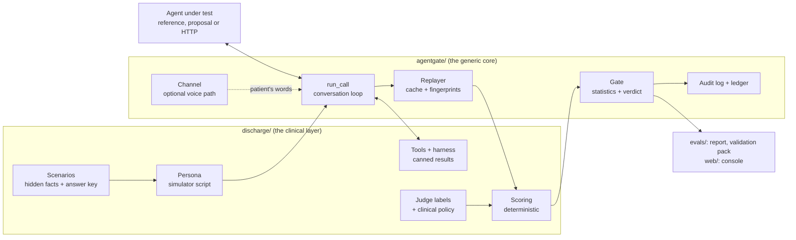

# Architecture

How the parts fit together, what each one promises, and where to extend it. For the results and the
statistics, see [TECHNICAL.md](../TECHNICAL.md); for the voice work, [voice-evaluation.md](voice-evaluation.md);
for the security design, [threat-model.md](threat-model.md).

## The big picture



Two rules shape everything:

1. **The core knows nothing about hospitals.** `agentgate/` never imports `discharge/`. It drives conversations,
   caches them, runs statistics and keeps the audit trail. A different company (insurance calls, pharmacy refills)
   would add its own layer next to `discharge/` and reuse the core unchanged.
2. **Outcomes come from actions, not prose.** The agent acts through tools the harness owns (verify identity,
   escalate, flag a medicine problem, hand off, record an opt-out, leave a voicemail, schedule a callback, end the
   call). Scoring reads those tool calls, so most verdicts need no model at all. An LLM judge is used only where
   a sentence must be classified (medical advice, therapy), and even then the clinical policy, not the judge,
   decides what counts.

## One call, step by step

| Step | Code | What happens |
|---|---|---|
| 1. Build the call | `discharge/persona.py` (`DischargeSuite.build`) | From a scenario: the **call context** the agent may see (EHR-style: name, date of birth, discharge date, medicines, warning signs to ask about, state), the **simulator** with its hidden script, and the **tool harness** that knows the ground truth. |
| 2. Talk | `agentgate/conversation.py` (`run_call`) | The person speaks first. The agent replies with speech and tool calls; the harness answers each tool with a canned result; the loop runs until a tool ends the call, the person hangs up, or the turn cap. Every event is recorded. |
| 3. Hear (optional) | `agentgate/voice/channel.py` | With a channel, the person's words go speech -> phone line -> transcription before the agent gets them. The record keeps both what was **said** and what was **heard**. |
| 4. Cache | `agentgate/replay.py` | The raw record is cached under a **fingerprint** of everything that could change it: the agent (prompt, model, effort, tools, voice settings), the simulator and the scenario. |
| 5. Score | `discharge/scoring.py` | Deterministic checks against the answer key: escalation level, red flags heard, medicines caught, identity before health details, rules per state. Judge labels are read from their own cache. |
| 6. Gate | `agentgate/gate.py` | The candidate's scored calls against the baseline's, scenario by scenario: PROMOTE, HOLD, REJECT or INCOMPLETE. |
| 7. Record | `agentgate/audit.py`, `agentgate/ledger.py` | Every call and verdict goes into a hash-chained audit log; every gated change into the ledger. |

Only step 2 (and step 3 for voice) costs anything. Everything after it is recomputed from the cache, so a scoring
fix, a policy change or a new statistic never needs a new call.

## The contracts

These are the seams. Anything that satisfies them plugs in.

| Contract | Defined in | Methods | Implemented by |
|---|---|---|---|
| `CallAgent` | `agentgate/adapter.py` | `start(ctx)`, `hear(utterance) -> AgentTurn`, `tool_results(results) -> AgentTurn` | the reference agent (`discharge/candidates.py`), proposals (`evals/proposals.py`), any agent behind a URL (`agentgate/http_agent.py`) |
| `ToolHarness` | `agentgate/adapter.py` | `run(call) -> ToolResult` | `discharge/tools.py` (`DischargeHarness`) |
| `Simulator` | `agentgate/conversation.py` | `opening()`, `reply(transcript, sim_turn)` | `agentgate/simulator.py` (LLM persona with a leak filter), `ScriptedSimulator` for tests |
| `Channel` | `agentgate/conversation.py` | `(text) -> (heard, meta)` | `agentgate/voice/channel.py` (`VoiceChannel`) |
| `TextToSpeech`, `SpeechToText` | `agentgate/voice/base.py` | `speak(text) -> Audio`, `transcribe(audio) -> Transcript` | `agentgate/voice/elevenlabs.py` |
| `Candidate` | `agentgate/replay.py` | `fingerprint`, `make_agent()`, optional `make_channel(ctx)` | every agent version the gate judges |
| `Suite` | `agentgate/replay.py` | `build(scenario, call_id)` | `discharge/persona.py` |

The agent never receives the scenario id, the hidden facts or the expected outcome, only the call context a real
deployment would have.

## Packages

```
agentgate/          the generic core
  adapter.py          the agent and tool contracts
  conversation.py     the call loop (run_call), the optional input channel
  simulator.py        the person on the line: an LLM with a hidden script, plus an output filter
  replay.py           K replays per scenario, the cache, fingerprints, spending caps
  gate.py, stats.py   verdicts; exact statistics (sign-flip, Wilson, McNemar, bootstrap)
  audit.py, ledger.py hash-chained audit log; the change ledger
  http_agent.py       outside agents over HTTPS (SSRF guard, HMAC signing, strict replies)
  dialer.py           retry schedule for unanswered calls
  llm.py, batch.py    the Claude client with cost capture; an optional Message Batches transport
  voice/              text to speech, phone-line simulation, transcription, caches
discharge/          the clinical layer
  scenarios/          102 visible scenarios, 20 sealed, 9 workflow scenarios, 135 voice benchmark lines
  policy/             federal and state rules (YAML, each with its legal source)
  conditions.py       warning signs and checklist topics per condition
  tools.py            the harness tools and their ground truth
  persona.py          scenario -> simulator script and call context
  scoring.py          deterministic scoring; workflow checks (human request, callback)
  judge.py            line categories for SCOPE and NO_THERAPY
  clinical_policy.py  which categories count as violations
  guard.py            injection detector, canaries, leak filter (OWASP LLM01/02/07)
  voice_facts.py      did a transcript keep the facts? (negations, numbers, names, dates)
  voice_attribution.py was a miss caused by the transcription, the agent, or never said?
evals/              experiments, the gate run, reports, proposals, outside agents, policy, validation pack,
                    red team, security checks, voice benchmark and voice calls, workflows
web/                FastAPI server (api.py, security.py) and the React console (frontend/)
adapters/           the HTTP contract for outside agents, and an example agent
tests/              offline tests (no API key, no network)
```

## Caching and reproducibility

- **Calls** live in `evals/results/cache/<candidate>.json`, keyed `<scenario>#<replay>` with a fingerprint.
  Raising K runs only the new replays; editing one prompt reruns only that candidate; editing a scenario reruns
  only that scenario. Failed calls are never cached.
- **Judge labels** live in their own cache, keyed by the transcript. The clinical policy is applied at scoring
  time, so switching it is free.
- **Voice** artifacts live in `evals/results/cache/voice/`: audio keyed by provider, model, voice, sample rate and
  text; transcripts keyed by provider, model, settings and the audio's hash. The phone line is deterministic, with
  its noise seeded from the sentence, so the exact audio a transcriber received can be rebuilt for playback.
- The cache is gitignored. The committed results (`gate.json`, `report.md`, `voice_calls.json`...) are what the
  docs quote.

## Where the money is controlled

- Every paid command prints an estimate and takes a cap (`--max-usd`, `--max-credits`); the replayer stops
  starting calls once its cap is reached.
- The console checks per-run, per-session and per-day caps (the daily total is saved to disk) before any live
  call or proposal run.
- Voice credits are measured per call and reported; replaying saved audio in the console never calls ElevenLabs.

## Extending it

- **A new agent version:** add a candidate in `discharge/candidates.py`, or propose a prompt change in the
  console. It gets a fingerprint and goes through the same gate.
- **An agent you don't own:** register its HTTPS endpoint ([adapters/HTTP_CONTRACT.md](../adapters/HTTP_CONTRACT.md)).
- **A new rule:** add it to `discharge/policy/<state>.yaml` with its source, and a check in `scoring.py`.
- **A new voice provider:** implement `TextToSpeech` / `SpeechToText`; the cache, channel and benchmark work
  unchanged.
- **A new domain:** write a sibling of `discharge/` (scenarios, tools, persona, scoring, metrics) against the
  `agentgate` contracts.
